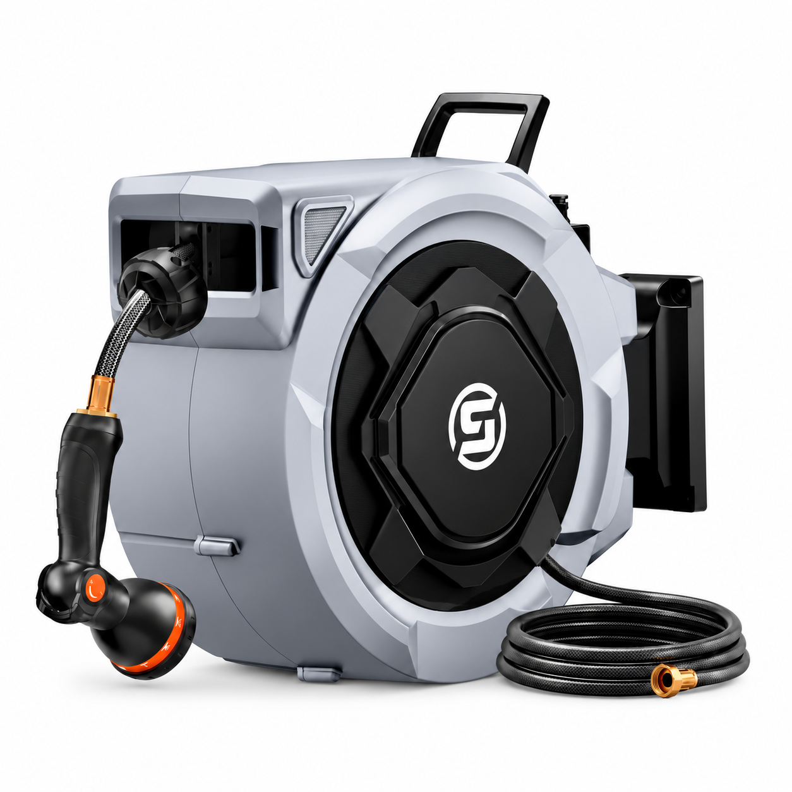
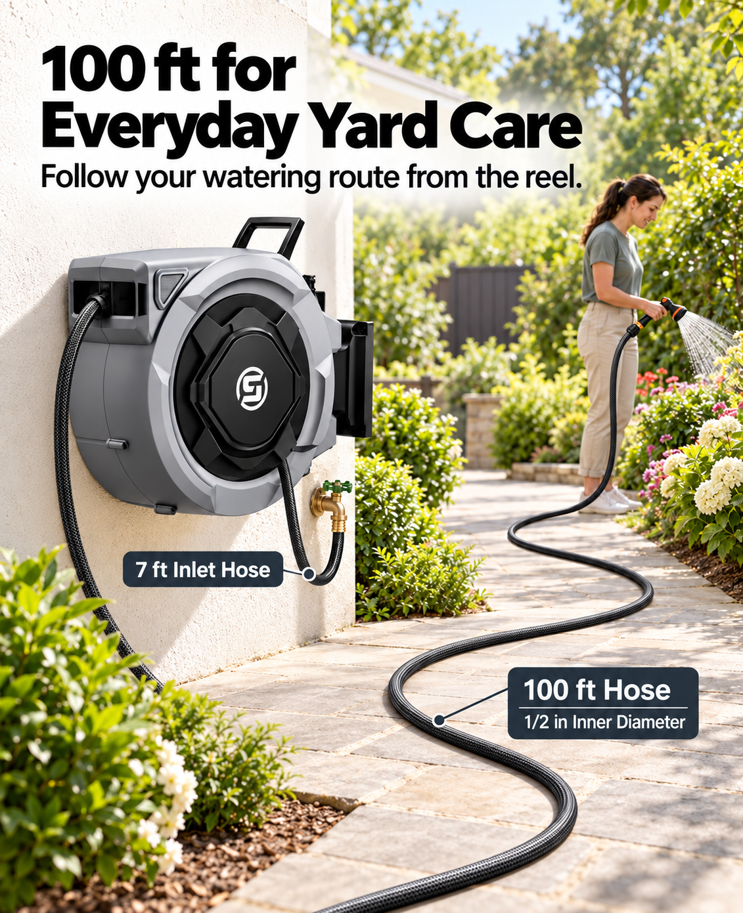
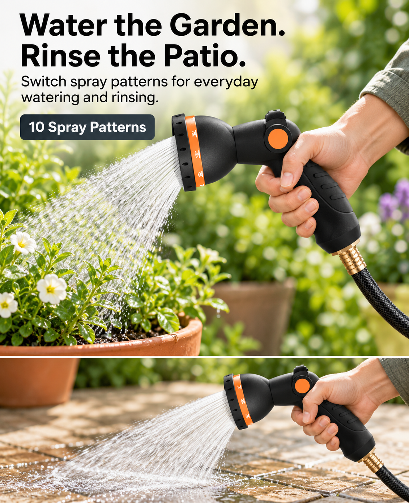
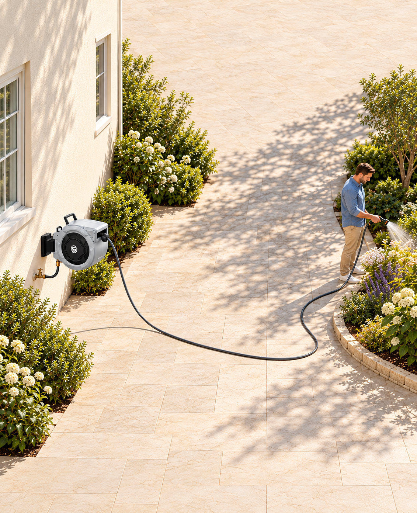

# Product Scene Studio

**通用场景图生成 Skill · v1**

把场景描述与可用参考变成自然、有体积、有材质层次的图片。适合环境底图、产品静物、使用场景、材质细节，以及换背景和光影调整。

重点是**有方向的光线、细腻的明暗过渡、可信的材质和空间关系**。默认不添加叠加文案；需要文字时使用你提供的原文。纯环境图只需描述场景，无需产品资料。

An agent skill for scene generation and product photography, with reusable lighting and material references.

[使用规则](SKILL.md) · [摄影基准](references/photographic-quality.md) · [光影参考](references/benchmarks.md) · [提示词示例](references/prompt-examples.md) · [MIT 许可证](LICENSE)

## 适合做什么

|需求|提供什么|重点|
|---|---|---|
|室内、户外、自然环境底图|场景描述；可补充用途、比例和留白要求|空间、光线、景别与可用的构图|
|产品静物与棚拍|当前产品实拍或可靠渲染图|轮廓、材质、受光与背景分离|
|产品使用场景|产品外观，以及动作涉及的部件依据|人、产品、环境的比例与接触|
|材质细节|能看清真实材料的参考图|光泽、微纹理与合理反射|
|换背景、改光影、局部编辑|待修改图片，以及改变项与保持项|检查修改效果及产品是否漂移|

概念产品可以依据设计描述创作。真实在售产品需要可靠的外观依据；缺少关键角度或连接结构时，会询问具体缺项。

## 摄影取向

- **光线塑造体积。** 同时考虑主光和环境补光，让受光面、过渡面和背光面可辨。
- **亮部有材质，暗部有层次。** 避免浅色表面过曝和黑色部件大面积死黑。
- **不同材料有不同响应。** 塑料、金属、皮肤、织物和地面分别处理，不套用统一亮边或滤镜。
- **主体属于场景。** 光向、反射、接触阴影、景深与环境一致，减少漂浮和贴图感。
- **风格服从当前需求。** 可做日间、阴天、棚拍、室内或夜景，不固定为花园、暖色或同一机位。

详细判断方法见 [摄影质量基准](references/photographic-quality.md)。

## 光影与质感参考

下面四张是随包携带的 **AI 生成参考图**。保留原图是为了保留已有的摄影观感；它们用于观察光影和材质，不代表产品结构、动作、尺度或文案全部正确。

**部分图内保留了产品标识和广告文字。** 这些内容不属于默认输出要求，不作为性能依据，也不应复制到新的场景中。参考图的题材不会限制你要生成的场景。

|静物的明暗与体积|日间环境光|
|---|---|
|||
|材质与接触近景|空间与阴影|
|||

第四张仍包含产品和人物，用于参考空间与阴影，不是可直接使用的空场景底图。各图的适用维度和局限见 [参考索引](references/benchmarks.md)。

## 使用前需要什么

本仓库提供 Skill 指令、摄影基准和参考图片，不包含独立的图像模型或运行服务。使用环境需要能：

1. 读取 `SKILL.md`、参考文档和本地图片。
2. 调用图像生成或编辑工具。
3. 查看实际成图；需要本地交付时，能够保存并检查文件。

有 `image_gen` 时优先使用它，其他环境按实际工具能力执行。`imagegen` 技能可以辅助工具操作，但不是本包摄影规则的必需依赖。没有图像工具时只能整理方案和提示词，不能直接出图。图像生成的可用性、费用和输出规格取决于你使用的服务。

## 安装到 Codex

### 下载并放入技能目录

下载 `v1` 发布包 `product-scene-studio-v1.zip`，解压后保留完整的 `product-scene-studio` 文件夹。

根据使用范围，放到以下任一位置：

|范围|位置|
|---|---|
|当前用户的项目通用|`~/.agents/skills/product-scene-studio/`|
|仅当前项目|项目根目录下的 `.agents/skills/product-scene-studio/`|

不要只复制 `SKILL.md`；`references/` 中的文档与图片也需要保留。若已有同名 Skill，先备份并确定要使用的版本，避免重复安装。

Codex 会检测技能变化；未出现时可重启。上述目录和发现方式依据 [OpenAI 官方 Skills 文档](https://learn.chatgpt.com/docs/build-skills)。

### 调用

在支持 `$` 技能调用的 Codex 界面中输入：

```text
$product-scene-studio
生成一张横版餐厨场景底图。清晨自然光，浅色墙面与木质台面，
光影有层次。右侧台面为后期放小家电留出自然区域。
不要产品、人物和叠加文字。
```

也可以从界面的技能选择器中选择“通用场景图生成”。在其他支持 Skill 的工具中使用时，按该工具的安装和调用方式配置；本仓库未逐一验证其他客户端。

## 更多调用示例

### 产品图

附上产品参考图，再输入：

```text
请用 $product-scene-studio，根据附件中的真实产品做一张静物摄影图。
保持产品外观和颜色，背景简洁，强调表面材质与柔和的明暗过渡。
不要新增文案，保留产品本身已有的标识。
```

### 延续某张图的质感

```text
请用 $product-scene-studio，参考附件的光影和质感，
生成一个雨后的室外石材庭院。借用明暗层次和材质表现，
场景内容按这次描述重新设计，不带入参考图中的产品、标识或文字。
```

### 调整现有图片

```text
请用 $product-scene-studio，把附件中的背景稍微提亮。
保持构图、产品形体与固有色，让暗部更有层次，保留接触阴影。
完成后检查产品是否发生变化。
```

### 生成一组场景

```text
请用 $product-scene-studio，生成三张室内阅读空间图：
清晨窗边、阴天客厅、夜间台灯。
共享自然材质和细腻明暗的摄影质感，分别设计机位和光源。
不要人物和叠加文字。
```

更多提示词组织方法见 [提示词示例](references/prompt-examples.md)。

## 工作方式与交付

1. **理解画面需求。** 查看本轮附件，区分产品依据、审美参考和编辑目标。
2. **确定摄影方案。** 选择机位、光源、材质、空间关系与必要留白。
3. **生成或编辑。** 使用当前环境可用的图像工具，明确改变项与保持项。
4. **看实际结果。** 检查主体、空间、光影、文字及可取得的文件规格；初稿后默认最多自动修正两轮。
5. **交付图片与轻量记录。** 保留提示词、参考用途、输出信息和必要的验收结论。

默认先生成一张；明确要求多张时完成指定范围。文件保存到你指定的位置，或当前工作区的 `outputs/product-scene-studio/` 下，以独立任务目录和版本文件名区分。

## 能力边界

- 不负责选品、评论分析、竞品调研、商业策划或平台上架审核。
- 样图只用于审美参考，不替代当前产品的外观和结构证据。
- 参考生成不能保证产品像素锁定，局部编辑后仍需复查保持项。
- 提示词中的尺寸、透明背景或字体要求不等于实际文件已达到要求；交付时按可核实的信息说明。
- 位图文字不等于可编辑文字图层。默认无新增叠加文字，也不会抹去真实产品本来已有的标识。
- 摄影规则帮助保持判断一致，不能保证每次生成都达到相同质量。本版本未提供跨题材的质量评分或稳定性保证。

## 文件结构

```text
product-scene-studio/
├── README.md
├── SKILL.md
├── LICENSE
├── VERSION
├── .gitignore
├── agents/
│   └── openai.yaml
└── references/
    ├── photographic-quality.md
    ├── prompt-examples.md
    ├── benchmarks.md
    └── benchmarks/
        ├── studio-product.png
        ├── daylight-garden.png
        ├── material-closeup.png
        └── scene-base.png
```

仓库仅包含通用技能、摄影参考和使用文档，不附带原始产品资料、建模原图、评论数据库、商业策划稿或生成任务日志。

## 版本与贡献

当前版本为 **v1**，以 [VERSION](VERSION) 和 `SKILL.md` 的版本元数据记录。

欢迎反馈可复现的问题。请说明场景需求、使用工具、预期与实际差异；附图前移除个人信息和不便公开的产品资料。新参考图应注明来源、可分享范围、适用的摄影维度和已知局限。

## 许可证

本仓库采用 [MIT License](LICENSE)。图片中的产品标识不代表品牌背书；许可证不授予这些标识的商标权。将生成结果用于具体项目时，仍需核对产品事实及所用素材的使用范围。
